# Ghost Data Still Exists: Deletion-Audit Agent

HackerRank Orchestrate, October 2026
([challenge](https://www.hackerrank.com/contests/hackerrank-orchestrate-october26/challenges/ghost-data-still-exists)).

**The problem.** A deletion workflow can report *Complete* while personal data
lives on in replicas, search indexes, exports, support attachments, analytics,
backups and logs, and while active syncs or restores can bring it back. For each of
518 requests, this agent decides whether the person actually asked for deletion.
It then reconstructs the true state of every copy at the case's `audit_at` time,
using only the supplied evidence, and writes the findings, an ordered
remediation plan and the verification checks to `output.csv`.

| Result (32 public samples) | |
|---|---|
| Status accuracy | **1.000** |
| Step precision / recall / F1 | 1.000 / 0.984 / **0.992** |
| Sequence accuracy | 0.906 |
| Full run | 518 rows in about 5 s, 11 vision calls once (Gemini free tier, $0), 0 calls on re-runs |

The three remaining sample misses involve ids that appear in no participant file
([evaluation report](code/evaluation/evaluation_report.md#2-error-analysis-every-remaining-miss)).

---

## Architecture

```mermaid
flowchart LR
    subgraph Inputs["dataset/"]
        M[evidence_files.csv<br/>manifest]
        E[evidence/<br/>SQL · JSON · logs · text · PDF · PNG]
        U[user_identities.csv<br/>user_audit_log.csv]
        A[system_activity.csv]
        R[deletion_rules.csv]
        Q[deletion_requests.csv]
    end

    E --> P[Evidence parsers<br/>evidence.py]
    M --> P
    PNG[11 screenshots] --> V[Vision: Gemini / Claude<br/>llm.py · cached JSON]
    V --> P
    P --> O[(Observations<br/>resource · ts · captured_at · fields)]
    U --> I[Identity index<br/>identity.py<br/>current + historical ids]
    Q --> C[Intent classifier<br/>intent.py · rules, 6+ languages]
    O --> L[Linking<br/>identifier tokens · one-hop refs<br/>policy-batch attribution]
    A --> L
    I --> L
    C -->|deletion authorized| X[Per-case auditor<br/>engine.py]
    C -->|not a deletion| NA[NOT_APPLICABLE, &#91;&#93;]
    L --> X
    R --> X
    X --> S[State at audit_at<br/>captured_at ≤ audit_at]
    S --> T[Treatment vs state<br/>DELETE · REDACT · ANONYMIZE<br/>RETAIN · DISABLE · BLOCK]
    T --> OR[Step ordering<br/>FINDING → REMEDIATION → VERIFICATION]
    OR --> CSV[output.csv]
    NA --> CSV
```



The same flow in plain text:

```text
evidence files ──► parsers (sql/json/log/text/pdf, +vision for png) ──► observations
user identities + audit log ──► identity index (all current & past ids)
request text ──► intent classifier ──► NOT_APPLICABLE?  ──yes──► []
                                        │no
observations + activity + identity ──► linked resources for the subject
each resource: latest state at audit_at  vs  required treatment (rules)
     ├─ violation ─► FINDING + REMEDIATION + (future) VERIFICATION
     └─ compliant ─► VERIFICATION citing the proving evidence
canonical ordering + step numbering ──► output.csv
```

## Design decisions

* **Rules first; the model only reads pixels.** Every decision (intent, linking, state, policy, plan) is deterministic Python. A vision model is used only to transcribe the 11 screenshots into JSON records, which then go through the same rules as an SQL row or a log line. The other 83 of the 94 evidence files never touch a model.
* **Deterministic and cached.** Each transcription is cached under the image hash, provider, model and prompt version. A re-run, including `--no-llm`, makes zero API calls and produces byte-identical output. Steps are sorted canonically (phase, operation order, system, resource) and serialized compactly.
* **Evidence time cutoff.** A case is decided only from evidence with `captured_at ≤ audit_at`. The latest determinate observation wins, and when two copies tie, the worse one wins (still present beats absent). A file captured after `audit_at` is never cited, even when it would change the answer (custom case C3).
* **Absence by omission.** A replica or snapshot that covers a system, but does not list a deleted record, proves the record absent at its capture time.
* **Batch linking of anonymized records.** An anonymized record no longer carries any identifier. The deletion worker processes each request's related records in a policy batch just before reporting its status, so a record is attributed to the request whose report follows that batch (custom case C6).
* **Rule 12 retention.** A security-audit record is RETAIN only within a supplied retention period. `retention_until()` reads `retention_until` fields and phrases such as *"retain until 25 Aug 2027"* that follow the record id in documents. A screenshot row supports RETAIN only if it shows such a period itself (custom case C5).
* **A screenshot is not proof of compliance it cannot show.** Listing a connector with a "Healthy" badge proves the connector exists, not that it is disabled. For DISABLE/BLOCK/REDACT/ANONYMIZE, screenshot observations that leave the deciding attribute unknown are ignored (custom case C7).
* **Remediation order.** Steps are ordered by operation: `DISABLE_DATA_FLOW` and `BLOCK_RESTORE` come before any `DELETE`/`REDACT`/`ANONYMIZE`, so nothing can recreate a record while it is being fixed. Within an operation, steps are sorted by system and resource. Every remediated record or process gets a matching verification step.

## Setup

Requires **Python 3.10+**. The engine and the Gemini provider use only the
standard library. Optional packages are listed in `code/requirements.txt`.

**Windows (PowerShell)**

```powershell
py -3 -m venv .venv
.\.venv\Scripts\Activate.ps1
pip install -r code\requirements.txt
Copy-Item .env.example .env     # then edit .env and set GEMINI_API_KEY (optional)
```

**Linux / macOS**

```bash
python3 -m venv .venv
source .venv/bin/activate
pip install -r code/requirements.txt
cp .env.example .env            # then edit .env and set GEMINI_API_KEY (optional)
```

`.env` is git-ignored and is never added to `code.zip`. A key is **only** needed
to transcribe screenshots that are not already cached. The shipped
`code/cache/` holds all 11, so the full run works offline without one.

| Variable | Meaning |
|---|---|
| `GHOST_LLM_PROVIDER` | `auto` (default: Gemini if `GEMINI_API_KEY` is set, else Anthropic if `ANTHROPIC_API_KEY` is set, else offline), `gemini` or `anthropic` |
| `GEMINI_API_KEY` | Free key from Google AI Studio |
| `GEMINI_MODEL` | Default `gemini-2.5-flash`; the submitted run used `gemini-3.8-flash` |
| `ANTHROPIC_API_KEY`, `GHOST_LLM_MODEL` | Alternative provider (`pip install anthropic`), default `claude-haiku-5-5` |

PDF text comes from poppler's `pdftotext` when it is on `PATH` (Git for Windows
includes it). Otherwise it comes from `pypdf`.

## Run

```bash
python code/main.py                          # full run: 518 requests -> ./output.csv
python code/main.py --requests sample        # 32 public samples -> code/evaluation/sample_predictions.csv
python code/main.py --no-llm                 # never call a model API (cached screenshots only)
python code/evaluation/main.py               # score sample predictions vs dataset/sample_output.csv
python code/evaluation/main.py -v            # ...and list every missing / extra step
python code/main.py --list-gemini-models     # flash models available to your GEMINI_API_KEY
python -m pytest code/tests                  # 29 tests + 1 documented xfail
python code/build_zip.py                     # package code.zip for submission
```

Expected output of the full run:

```text
wrote 518 rows
```

`output.csv` has the columns `case_id,deletion_status,steps_json`, sorted by
`case_id`. Statuses: 350 INCOMPLETE, 158 COMPLETE, 10 NOT_APPLICABLE.
The full run takes about 5 seconds on a laptop (evidence is loaded and indexed once).
The full run also writes `code/evaluation/usage_summary.json`, which feeds the
[usage report](code/evaluation/usage_report.md).

## Repository layout

```text
README.md                      this file
.env.example                   configuration template (copy to .env)
output.csv                     submission: one row per request
code/
  main.py                      CLI entry point
  requirements.txt             optional dependencies (pypdf, anthropic, pytest)
  build_zip.py                 builds code.zip (excludes .env, dataset/, venvs, __pycache__)
  ghost_audit/
    evidence.py                format-generic parsers -> observations, coverage markers
    identity.py                current + historical identifier index
    intent.py                  deletion vs. non-deletion request classifier
    engine.py                  linking, state at audit_at, policy, planning, ordering
    llm.py                     vision providers (Gemini via urllib, Anthropic SDK), cache, usage
  cache/                       cached screenshot transcriptions (JSON, no secrets)
  evaluation/
    main.py                    evaluator: status, step P/R/F1, field and sequence accuracy
    evaluation_report.md       metrics, error analysis, custom cases, ablation
    usage_report.md            model calls, tokens and cost of the final run
  tests/                       pytest: units, fixture scenarios, offline sample regression
```

## Limitations

* Records that exist only by naming convention or only in the answer key are not reported (3 sample steps; see the evaluation report).
* The intent classifier is a rule lexicon. A deletion request phrased as *"delete … every copy of my data"* trips the export cue (pinned by a strict xfail; no dataset request uses it).
* PDFs are linked as whole documents: every id in a PDF is tied to every identifier in it. This suits the single-subject business documents here, but would over-link a multi-subject report.
* Screenshot facts depend on the transcription. Results are cached and auditable in `code/cache/`, but a wrong transcription would flow into the answer.
